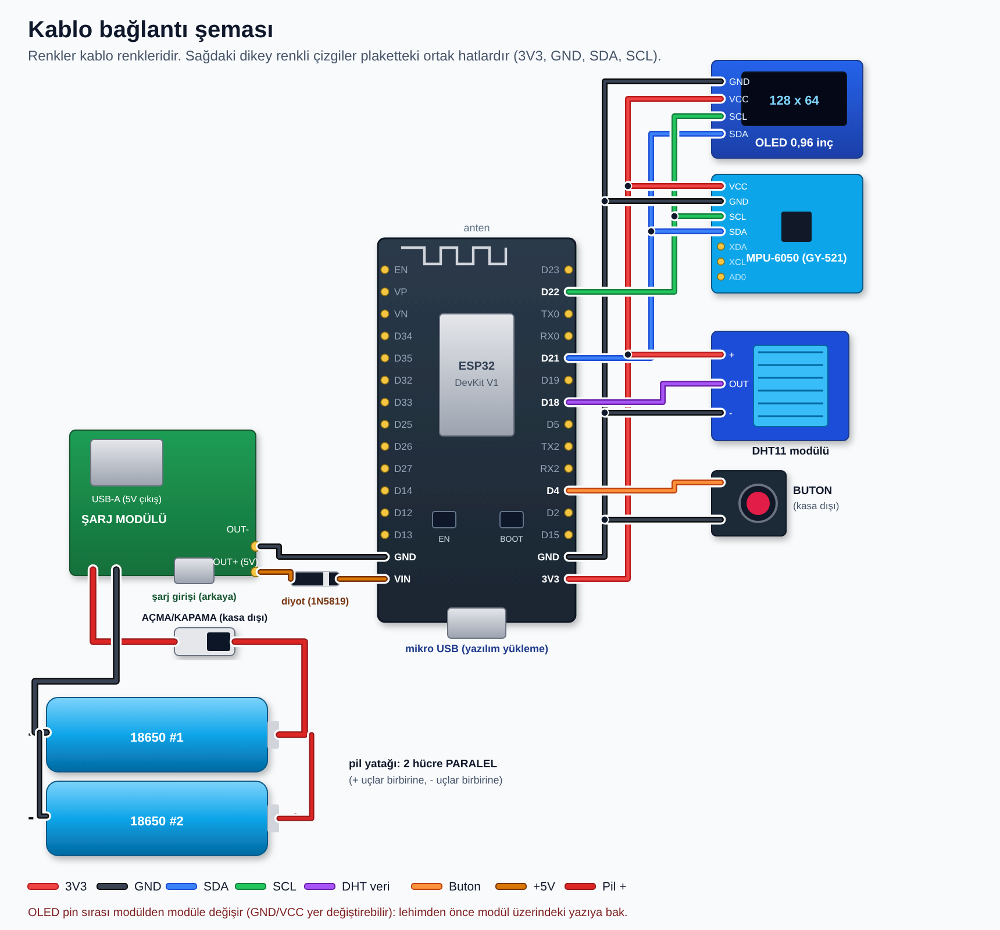

# Moto Lean-Angle Gauge

**A battery-powered lean-angle gauge for a racing motorcycle, built on ESP32 + MPU-6050 with a 128×64 OLED arc display.**

[](#hardware)
[](#build--flash)
[](LICENSE)
[](#roadmap)

🇹🇷 [Türkçe README](README.tr.md)

<!-- TODO: add a photo or short GIF of the running display here, e.g. docs/images/demo.gif -->

## Features

- **Live lean angle** from a gyro + accelerometer complementary filter, ~20 Hz screen refresh
- **Persistent left/right max lean**, stored in ESP32 flash (NVS) so it survives power-off
- **Animated half-arc gauge** with max markers, big centre readout and a boot sweep animation
- **Ambient temperature** (DHT11) in the corner of the screen
- **One-button UI**
  - short press: zero the mounting offset (only accepted if the device was still for 0.4 s, otherwise shows `HAREKET VAR` / "moving")
  - long press (2 s): clear the stored max values
- **Gyro bias calibration** on every boot
- **Single 18650 Li-ion cell** (second cell in parallel planned) with protection and 5 V boost

## How it works

```
 MPU-6050 ──I²C──┐
 (±4 g, ±1000°/s)│            ┌───────────────────────────┐
                 ├── ESP32 ──►│ complementary filter       │──► SSD1306 OLED (I²C, 400 kHz)
 DHT11 ──GPIO18──┤            │ max tracking → NVS         │
 Button ─GPIO4───┘            └───────────────────────────┘
```

**Sensor fusion.** The roll rate from the gyro is integrated every loop (`angle += (gx - bias) * dt`). The accelerometer angle (`atan2(ay, az)`) pulls the estimate back slowly (gain 0.01), but **only when the total acceleration is close to 1 g** (0.9–1.1 g). In a corner the bike is under lateral load, so the accelerometer alone would read the wrong angle; gating the correction keeps the gyro in charge while cornering and still removes drift on straights.

**Max values.** The max is tracked on a smoothed angle and written to NVS 2 s after the last increase, to limit flash wear.

**Display.** The arc, filled bar and max dots are drawn with filled polygons on the Adafruit GFX library. Right-aligned text uses `128 - strlen * 6` with text wrap disabled.

## Hardware

| Part | Notes |
|---|---|
| ESP32 DevKit V1 (30-pin, CP2102) | Main board |
| SSD1306 0.96" 128×64 I²C OLED | Display |
| MPU-6050 (GY-521) | 3-axis accel + 3-axis gyro |
| DHT11 | Temperature |
| Push button | Momentary, to GND |
| 18650 Li-ion cell(s) | 1 now, 2 in parallel planned |
| Power-bank module (DW01A + 8205S, 5 V boost) | Protection, charging, 5 V out |
| 1N5819 Schottky diode | 5 V → VIN, cathode to VIN |

### Wiring

| Signal | ESP32 pin |
|---|---|
| I²C SDA (OLED, MPU-6050) | GPIO21 |
| I²C SCL (OLED, MPU-6050) | GPIO22 |
| DHT11 data | GPIO18 |
| Button (other leg to GND) | GPIO4 (`INPUT_PULLUP`) |
| Sensors / OLED VCC | 3V3 |
| Power in (via 1N5819) | VIN |



More detail (perfboard hole map, two-layer stack, enclosure, power notes): [docs/hardware.md](docs/hardware.md).

## Build & flash

1. Install the [Arduino IDE](https://www.arduino.cc/en/software) and the **ESP32 board package** (Espressif).
2. Install the libraries from the Library Manager:
   - Adafruit GFX Library
   - Adafruit SSD1306
   - DHT sensor library (Adafruit)
3. Open `firmware/yatis_gostergesi/yatis_gostergesi.ino`.
4. Select **ESP32 Dev Module**, choose the port, upload.
5. Keep the device still for the first seconds after power-on (gyro calibration).
6. Mount it upright and short-press once to store the zero offset.

If left and right are swapped on your mounting, change `#define SIGN -1` to `1`.

## Project layout

```
firmware/yatis_gostergesi/   Arduino sketch
docs/hardware.md             BOM, power, perfboard map, enclosure
docs/images/                 Wiring, hole map, stack and enclosure drawings
```

## Roadmap

- [x] Firmware: filter, NVS max, arc display, button UI
- [x] Power system bench test on one cell
- [ ] Measure real current draw and battery life
- [ ] Second cell, power switch, battery % (voltage divider + ADC)
- [ ] Solder the two-layer perfboard
- [ ] Enclosure (~175 × 44 × 36 mm) with damper balls and action-cam mount
- [ ] Stronger vibration filtering after a ride test
- [ ] Ride test on track

## License

[MIT](LICENSE)
