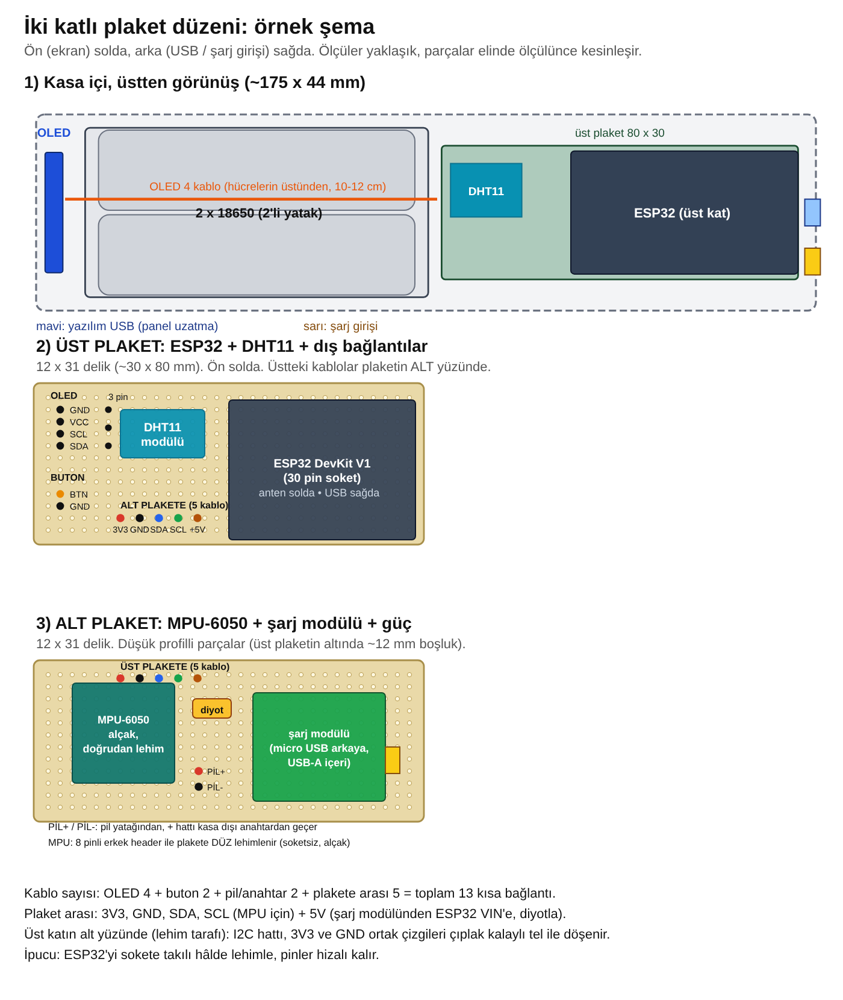
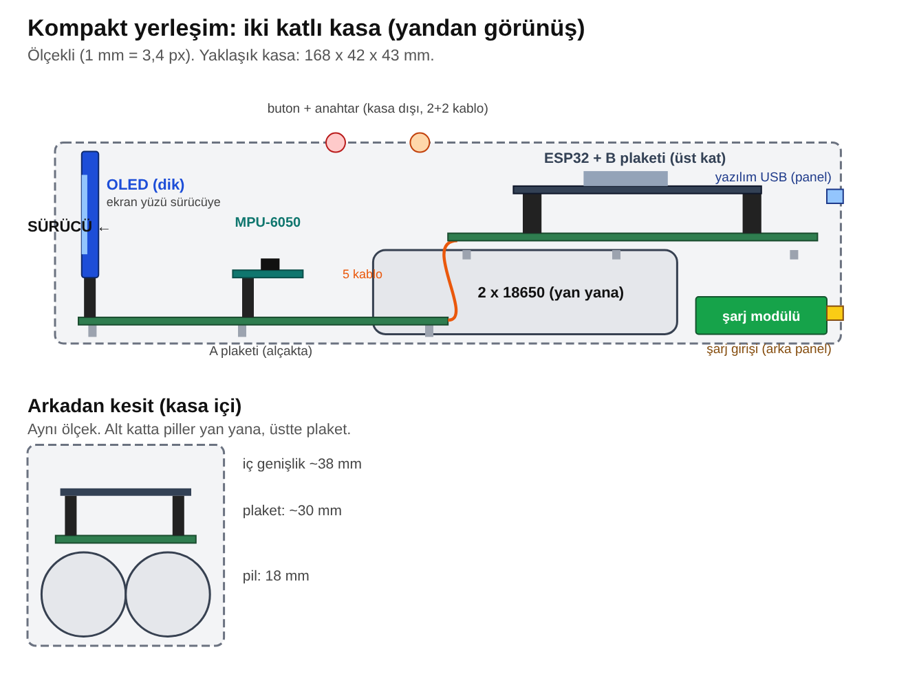
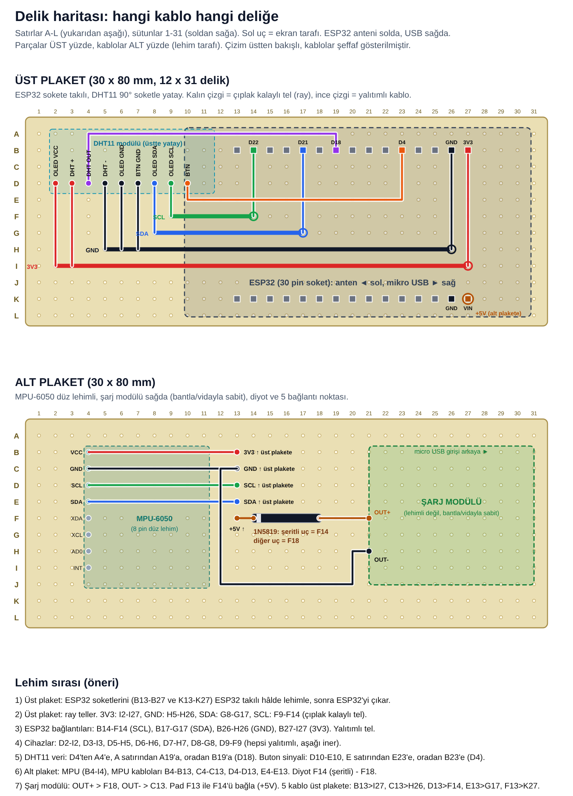

# Hardware notes

## Power

- 18650 Li-ion cell(s), 1500 mAh each. One fitted now; a second will go in parallel (3000 mAh). Before paralleling, cell voltages must be within 0.1 V.
- Reused power-bank module: DW01A + 8205S protection, micro-USB charging, 5 V boost on a USB-A output.
- Module 5 V → 1N5819 Schottky → ESP32 VIN (cathode/stripe to VIN), so USB programming and battery power don't fight.
- Bench test: cell ~3.93 V, module output 5 V. Estimated draw 70–100 mA at 5 V (~135 mA from the cell), so roughly 7–12 h on 1500 mAh. **Not measured yet.**
- Planned power switch on the battery + line, before the module. With this module the cell charges through the same line, so the switch must be on while charging.

## Mechanical

- Long, two-layer enclosure, about 175 × 44 × 30–36 mm.
- OLED upright at the front behind a window, 2×18650 holder in the middle, two-layer perfboard at the back on M3 standoffs (12–20 mm).
- Upper board (30 × 80 mm, 12 × 31 holes): ESP32 in female headers, DHT11 on a 90° header.
- Lower board: MPU-6050, charge module, diode; 5 wires to the upper board.
- Button and power switch outside the case; charge input and a USB extension for firmware updates on the rear panel.
- Mounting: universal action-cam mount with FPV-drone damper balls between case and bike.

## Perfboard hole map

Rows A–L, columns 1–31, left = display side. Full plan with solder order:

- ESP32 sockets B13–B27 and K13–K27. D22 = B14, D21 = B17, D18 = B19, D4 = B23, GND = B26, 3V3 = B27, VIN = K27.
- Rails (bare tinned wire, bottom side): 3V3 I2–I27, GND H5–H26, SDA G8–G17, SCL F9–F14.
- Lower → upper board: B13→I27 (3V3), C13→H26 (GND), D13→F14 (SCL), E13→G17 (SDA), F13→K27 (+5 V).

Parts may shift by a hole or two once placed; what matters is that each net lands on the right rail. Check OLED and DHT11 pin order on the actual modules.

## Known issues

- DHT11 reads high (self-heating / placement near the ESP32 suspected).
- MPU drifts under vibration; filtering will be tuned after a ride test.
